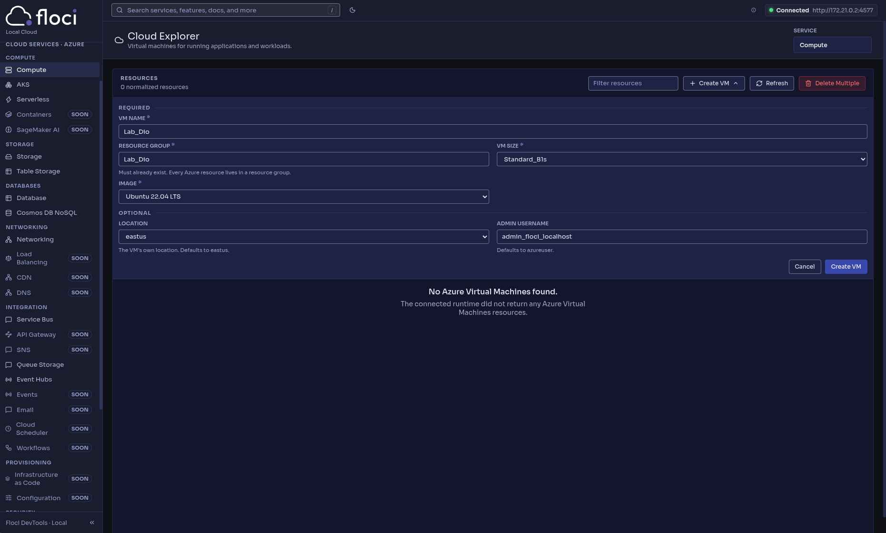
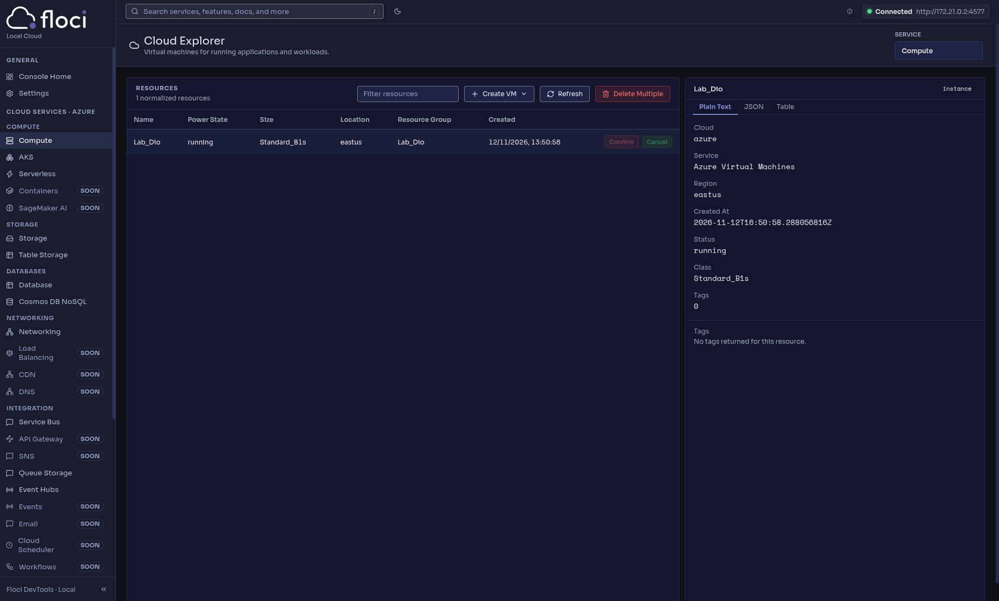

# AZ-900 Certification

This repository contains notes and learnings from the DIO AZ-900 Certification Bootcamp.

## Table of Contents

- [Lessons Learned](#lessons-learned)
  - [Cloud Computing](#cloud-computing)
  - [Cloud Types](#cloud-types)
  - [Comparison Between Cloud Models](#comparison-between-cloud-models)
  - [CapEx vs. OpEx](#capex-vs-opex)
  - [Cloud Benefits](#cloud-benefits)
  - [Virtual Machines & Local Lab](#virtual-machines--local-lab-floci-az)

## Lessons Learned

During this bootcamp, up to the last update of this README file, several core concepts regarding Cloud Computing were covered - describing it as a virtualized data center comprising services, resources, and applications.

### Cloud Computing

Cloud computing is the delivery of computing services over the internet -  including data storage, servers, databases, networking, and software -  enabling faster innovation, flexible resources, and economies of scale.

This model is especially beneficial for companies that need to provision and scale resources rapidly.

#### Cloud Types

- **Private Cloud:** The organization creates and maintains its own cloud environment within its local data center. The company is fully responsible for operating the services, and external users do not have access.

- **Public Cloud:** This type of cloud delivers computing resources over the internet to multiple organizations. Data centers are globally distributed to deliver the resources. The key features of a public cloud are: belonging to a cloud service or hosting provider; supplying resources and services to numerous organizations and users; and being accessed through a secure connection (usually over the internet).

- **Hybrid Cloud:** Uses both on-premises infrastructure (private cloud) and public cloud, allowing seamless communication and data sharing between the two environments.

- **Multicloud:** The use of two or more public clouds from different providers, such as AWS, Azure, and GCP. Private clouds can also be part of a multicloud architecture.

#### Comparison Between Cloud Models

- **Public Cloud:** There is no upfront expense (CapEx) required to scale. Applications can be provisioned and de-provisioned rapidly, organizations pay only for what they use, and the provider handles physical responsibilities such as electricity, cooling, and hardware security.

- **Private Cloud:** Organizations have full control over resources and security. They are fully responsible for maintaining and updating the hardware and managing the data center.

- **Hybrid Cloud:** Organizations choose where they want to execute their applications while maintaining full control over security, compliance, and legal requirements. This model offers the highest operational flexibility.

#### CapEx vs. OpEx

- **Capital Expenditure (CapEx):** The initial monetary expense associated with physical infrastructure. This type of expense typically depreciates in value over time.

- **Operational Expenditure (OpEx):** Ongoing spending on products and services as needed, billed immediately and based on actual consumption.

- **Consumption-Based Model:** Cloud service providers operate on a consumption-based model, meaning end users pay only for the exact resources they use. This provides high precision regarding expenses due to individual pricing for services and consumption-based billing.

## Cloud Benefits

The cloud provides numerous benefits for its users. Among the benefits there are

1. [High Availability](#high-availability)
2. [Scalability](#scalability)
3. [Elasticity](#elasticity)
4. [Global Scale, Resilience & Reliability](#global-scale-resilience--reliability)
5. [Predictability](#predictability)
6. [Security & Cloud Models](#security--cloud-models)
7. [Governance & Compliance](#governance--compliance)
8. [Manageability](#manageability)
9. [Virtual Machines & Local Lab (Floci-AZ)](#virtual-machines--local-lab-floci-az)

### High Availability

High Availability refers to a system design to run continuously and remain accessible from anywhere. Its resources are always available whenever needed.
It ensures that users always experience optimal service quality aligned with the *Service Level Agreement* (SLA).
High availability focuses on guaranteeing maximum uptime, regardless of any interruptions or events that may occur. If the SLA is not met by the cloud provider, a credit voucher will be provided.
To achieve high availability and remain resilient against scheduled interruptions or unexpected events, the cloud provider offers a *Disaster Recovery* service. Additionally, cloud users can scale horizontally, distributing their services across multiple global regions.

### Scalability

Scalability refers to the ability to adjust resources to meet fluctuating demands, meaning you can add more resources to effectively handle higher workloads.
Another benefit of scalability is that you never pay more than necessary for cloud services. Because the cloud operates on a consumption-based model, you are only billed for what you actually use.
If demand decreases, resources can also be scaled down, which consequently reduces your costs.
There are two main scalability approaches:

- **Scaling up (Vertical Scaling)**: Increasing the capacity of and existing resource by adding more processing power such as vCPUs or RAM.
- **Scaling out (Horizontal Scaling)**: Adding more virtual machines ([Virtual Machines & Local Lab](#virtual-machines--local-lab-floci-az)) to distribute the load.

### Elasticity

Elasticity has a definition similar to scalability, but it specifically focuses on handling unexpected demand spikes. In this scenario, resources can be scaled - either automatically or manually - to meet that sudden demand.
Unlike scalability, elasticity involves unpredictable scenarios where there is no prior notice of when or how much capacity will be needed to grow.
The environment can also be scaled based on a real-time request. For example, you can provision more virtual machines ([Virtual Machines & Local Lab](#virtual-machines--local-lab-floci-az)) or Docker containers through horizontal expansion. Conversely, when demand or requests experience a significant drop, those added resources can be reduced horizontally (manually or automatically).

#### Comparison: Scalability vs. Elasticity

##### 1. Scalability (The Capability)

Scalability is an architectural characteristic of a system. It defines whether your system can handle an increasing workload - either bu increasing the size of a single server (scale up/vertically) or by adding more server (scaling out/horizontally);

- **Focus**: Being prepared for medium- and long-term growth.
- **How it usually happens:** Often involves planning or manual intervention (e.g., noticing your website traffic has doubled over the past 6 months and deciding to upgrade your cloud server).

##### 2. Elasticity (Automation & Dynamism)

Elasticity goes a step beyond scalability; it introduces real-time automation. An elastic system can detect sudden traffic spikes, automatically provision more resources within minutes and - most importantly - decommission those resources as soon as the spike passes, ensuring you don't pay for idle capacity.

- **Focus**: Instantly adapting to short-term, unpredictable demand fluctuations.
- **How it usually happens:** 100% automated via scaling policies (Auto Scaling).

##### Practical Examples

1. **Scalability Example**
Imagine a tax return filing system. Every year, it is widely known that traffic surges drastically in April. The IT team plans ahead and, either manually or via scheduled maintenance, upgrades the database server to a more powerful machine (with more RAM and CPU) for that month. This is vertical scaling (scalability).
2. **Elasticity Example**
Imagine an e-commerce website where a surprise social media post makes a product go viral overnight. Within 5 minutes, active users jump from 100 to 10,000 simultaneously. The cloud provider detects the CPU spike, automatically spins up 10 new instances (containers/virtual machines) to share the load, and 2 hours later - once the traffic dies down - automatically shuts them all down, returning infrastructure costs to baseline. This is elasticity.

##### Comparison Table

| Criteria          | Scalability                                               | Elasticity                                                                                                    |
|-------------------|-----------------------------------------------------------|---------------------------------------------------------------------------------------------------------------|
| Main Focus        | Handling gradual or long-term workload growth             | Adapting rapid, sudden, and unpredictable short-term fluctuations                                             |
| Automation Level  | Often requires manual planning or human intervention      | Fully automated (scales up and down on its own)                                                               |
| Primary Dimension | Can be vertical (upsizing) or horizontal (adding servers) | Predominantly horizontal (adding/removing instances dynamically)                                              |
| Cost Optimization | Prevents permanent over-provisioning (pays-as-you-go)     | Maximizes savings by turning off resources the exact moment they are no long needed                           |
| Analogy           | Buying pants with spandex (they stretch to fit better)    | A rubber band that stretches when pulled hard and snaps back to its original size automatically when released |

### Global Scale, Resilience & Reliability

This is closely related to **resilience**. Due to its decentralized architecture, the cloud naturally supports a reliable and resilient infrastructure, allowing users to deploy resources across multiple global regions.
Thanks to **global scale**, even if a catastrophic event occurs in one specific region, other regions will remain up and running.
Additionally, it allows you to easily set up **Disaster Recovery (DR)** environments and data replication strategies.

### Predictability

Predictability in the cloud allows you to move forward with confidence, whether regarding performance or costs.
Both aspects are guided and supported by the **Microsoft Azure Well-Architected Framework**.

### Security & Cloud Models

The cloud offers security tools that fulfill customers' needs, but it is important remember that the implementation of many of these tools must be performed by the customer itself (Shared Responsibility Model).

#### Infrastructure as a Service (IaaS)

If you require maximum security control, IaaS provides the underlying physical resources while allowing you to fully manage the operating systems and installed software, including applying patches and handling maintenance.

#### Platform as a Service (PaaS) & Software as a Service (SaaS)

If you prefer patch management and maintenance to be handled automatically, PaaS or SaaS implementations are often the best cloud strategies for this scenario.

### Governance & Compliance

Cloud-based auditing helps identify any resources that are out of compliance with corporate standards and provides remediation strategies.
For instance, it is possible to block resource creation in specific global regions. These solutions rely on rule-based models that must be followed, such as company policies or governmental regulations applicable to the company's industry.
Establishing governance presence as early as possible ensures your cloud environment remains up-to-date, secure, and well-managed.

### Manageability

One of the primary benefits of cloud computing is its robust manageability options, which significantly streamline administration for cloud users.
There are two main perspectives or approaches to manageability in the cloud:

1. **Management of the cloud**
Refers to configuring and managing cloud resources themselves (such as scaling, provisioning, monitoring, and updating virtual machines or services).
2. **Management in the cloud**
Refers to how you interact with and manage the cloud environment using developer portals, command-line interfaces (CLI), templates (Infrastructure as a Code), and automation tools provided by the cloud vendor.

## Virtual Machines & Local Lab (Floci-AZ)

This section documents the step-by-step procedure implemented to set up, configure, and operate a local Azure emulation environment using **Floci-AZ** on a Debian host, detailing custom cloud registration and resource group creation via direct REST API calls.

### 1. Custom Cloud Registration in Azure CLI

By default, the Azure CLI points to Microsoft's global production endpoints. Registering and setting a custom cloud named `floci-local` redirects the Azure Resource Manager (ARM) scope and metadata to the emulator container's local port (`4577`).

```bash
az cloud register \
  --name floci-local \
  --endpoint-resource-manager http://localhost:4577 \
  --endpoint-active-directory http://localhost:4577

az cloud set --name floci-local
```

### 2. Creating the Resource Group (`Lab_Dio`) via HTTP POST

Because internal MSAL token validation in the Azure CLI restricts standard `az login` flows in purely emulated local HTTP environments, resource provisioning was executed directly via direct HTTP REST requests.
The `POST` method was sent to the emulator's official subscription ID(`00000000-0000-0000-0000-000000000001`), establishing the logical container `Lab_Dio` in the `eastus` region and return a `Succeeded` provisioning state for immediate UI synchronization (`/_floci/ui`).

```bash
curl -X POST "http://localhost:4577/subscriptions/00000000-0000-0000-0000-000000000001/resourcegroups/Lab_Dio?api-version=2021-04-01" \
  -H "Content-Type: application/json" \
  -d '{
    "location": "eastus"
  }'
```

### 3. Visual Validation (Floci-AZ UI)

Below are screenshots demonstrating the Floci-AZ environment and the created resource group:
Figure 1: Custom cloud setup and initialization in Floci-AZ.

Figure 2: Resource group successfully provisioned and displayed in the Floci-AZ dashboard.

